# Lecture 01 — Computer Vision Foundations & Advanced Models

**Duration:** 60 minutes · **Format:** lecture + discussion · **Hands-on:** [Project — VLMs for data labeling](../../projects/vlm_autolabel/README.md)

> **Big idea.** Computer vision moved from *one model per task, trained on labeled data* to
> *one large pretrained model, adapted to many tasks with prompts, probes, or light fine-tuning*.
> Today we map that shift: what vision models are asked to do, how they learn representations,
> how they generate images and video, and how the same recipe is spreading to healthcare,
> robotics and self-driving.

---

## Agenda

| Time | Block | Key question |
|------|-------|--------------|
| 0–5 | 1. From task models to foundation models | What changed after 2020? |
| 5–15 | 2. Vision functions & the scaling story | What do we ask vision models to do, and what did scale buy? |
| 15–25 | 3. Representation learning | How does a model learn useful features without labels? |
| 25–35 | 4. Promptable vision & vision-language models | How do you "talk" to a vision model? |
| 35–43 | 5. Generative computer vision | How did image/video generation get so good, and why does it matter for perception? |
| 43–55 | 6. Domain foundation models: healthcare, robotics, driving | What transfers, what doesn't? |
| 55–60 | 7–8. Open problems + class project | What can *you* do without a GPU cluster? |

---

## 1. From task models to foundation models (5 min)

A **foundation model** (Bommasani et al., 2021) is trained on broad data at scale and adapted to many
downstream tasks. In vision, three things made this possible around 2020–2021:

1. **Architecture** — the Vision Transformer (ViT, Dosovitskiy et al., 2020) treats an image as a
   sequence of 16×16 patches, so vision could reuse the scaling playbook from language.
2. **Data without manual labels** — web image–text pairs (CLIP, ALIGN) and self-supervised
   objectives (MAE, DINO) removed the ImageNet-labeling bottleneck.
3. **Compute** — training runs grew by orders of magnitude.

| Old paradigm (≈2012–2019) | Foundation-model paradigm (2020–) |
|---|---|
| Train from scratch or from ImageNet per task | Start from a frozen/pretrained backbone |
| Fixed label set (1,000 classes, 80 COCO classes) | Open vocabulary — classes given as text |
| Output = class / box / mask | Output = any of those, *plus* text, actions, images, video |
| Adaptation = full fine-tuning | Adaptation = prompting, linear probe, LoRA, in-context examples |

---

## 2. Vision functions & the scaling story (10 min)

**Core vision functions** — the "API" of a perception system:

| Function | Classic models | Foundation-era models |
|---|---|---|
| Recognition / classification | AlexNet, ResNet | CLIP, SigLIP 2 (zero-shot, text-defined classes) |
| Detection | Faster R-CNN, YOLO | Grounding DINO, OWLv2, YOLO-World (open-vocabulary) |
| Segmentation | U-Net, Mask R-CNN | SAM / SAM 2 / SAM 3 (promptable, video, concepts) |
| Depth & 3D | stereo, SfM | Depth Anything V2, DUSt3R/MASt3R, VGGT (feed-forward 3D) |
| Tracking / video | SORT, optical flow | SAM 2 memory, CoTracker |
| Description & reasoning | captioning CNN-RNN | VLMs: LLaVA, Qwen2.5-VL, Gemini, GPT-4o |
| Generation | GANs | Diffusion/flow transformers, Veo / Sora / Cosmos video models |
| Action | task-specific policies | Vision-language-action models (RT-2, OpenVLA, π0) |

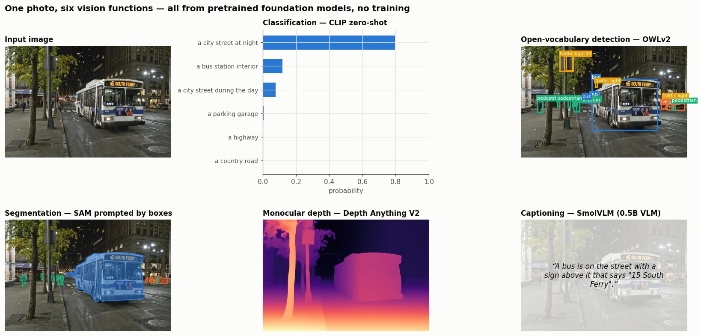
*Real outputs, no training: CLIP picks the scene label, OWLv2 finds objects from text, SAM turns
boxes into masks, Depth Anything estimates depth and a 0.5B VLM writes a caption. Ask the class to
spot what is missed (distant pedestrians, parked cars).*

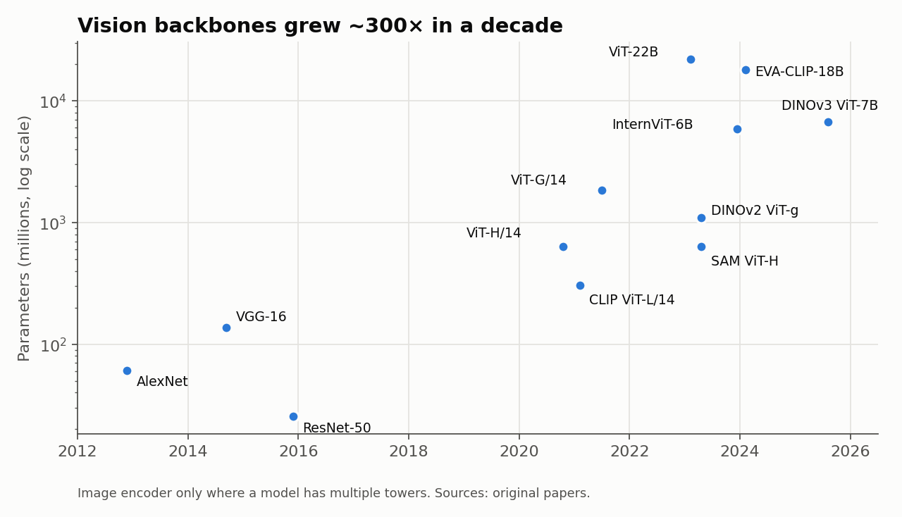

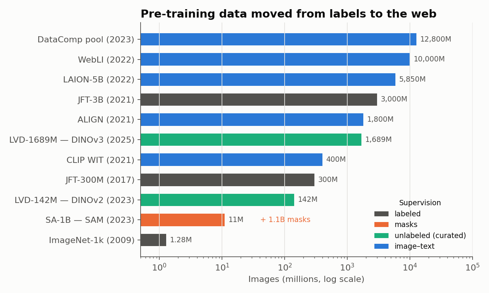

**Talking points**

- Backbones went from 61M (AlexNet) to 22B (ViT-22B) parameters — but note that the most-used
  backbones today (DINOv2/v3, SigLIP, SAM encoders) are typically **0.3–1B**: big enough to be general,
  small enough to deploy. The 7B DINOv3 teacher is *distilled* into ViT-S/B/L students.
- Data moved from 1.28M human-labeled images to billions of web pairs. Labels became **text**
  (CLIP) or **nothing at all** (DINO). SA-1B is the exception: its 1.1B masks were produced by a
  *model-in-the-loop data engine* — the idea behind today's project.
- Ask the class: *What is lost when we replace curated labels with web data?* (bias, licensing,
  long-tail domains such as medical scans are nearly absent.)

---

## 3. Representation learning (10 min)

The goal: learn an encoder $f(x)$ whose features make downstream tasks easy (linearly separable,
spatially meaningful, robust).

| Family | Idea | Representative work |
|---|---|---|
| Supervised pretraining | Predict human labels | ImageNet ResNets, JFT ViTs |
| Contrastive (image–image) | Two augmented views of the same image should match; others shouldn't | SimCLR, MoCo (2020) |
| Self-distillation | Student matches a momentum teacher; no negatives | BYOL, DINO, **DINOv2 (2023)**, **DINOv3 (2025)** |
| Masked modeling | Reconstruct masked patches | BEiT, **MAE** (2021) |
| Predictive in latent space | Predict *embeddings* of masked regions, not pixels | I-JEPA (2023), **V-JEPA 2** (2025) |
| Image–text contrastive | Match images with their captions | **CLIP**, ALIGN (2021), SigLIP / **SigLIP 2** (2023/25) |

The CLIP contrastive loss for a batch of $N$ pairs with image embeddings $u_i$ and text embeddings $v_i$:

$$
\mathcal{L} = -\frac{1}{2N}\sum_{i=1}^{N}\left[\log\frac{e^{u_i^\top v_i/\tau}}{\sum_j e^{u_i^\top v_j/\tau}} + \log\frac{e^{u_i^\top v_i/\tau}}{\sum_j e^{u_j^\top v_i/\tau}}\right]
$$

SigLIP replaces the softmax with an independent sigmoid per pair, which scales better to huge batches.

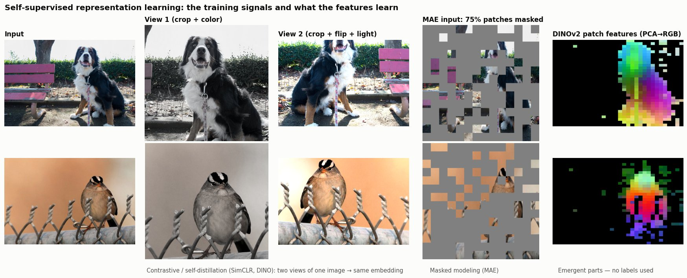
*Left: two augmented "views" that contrastive / DINO training pulls together. Middle: the MAE input
with 75% of patches hidden. Right: DINOv2 patch features projected to RGB — the same colors land on
the same body parts (head, chest, legs) although the model never saw a label.*

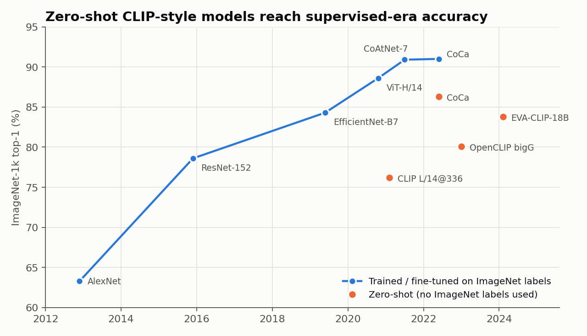

**Talking points**

- A CLIP model never trained on ImageNet labels classifies ImageNet at 76% just from the
  prompt "a photo of a {class}" — matching the original fully supervised ResNet-50.
- **Which features for which job?** CLIP/SigLIP features are *semantic* (good for
  classification, retrieval, VLM inputs). DINOv2/v3 features are *spatially dense* (good for
  segmentation, depth, correspondence, medical images). Many VLMs now combine both.
- Evaluating a representation: **linear probe**, **k-NN**, **zero-shot**, and dense probes
  (segmentation/depth heads on frozen features).

---

## 4. Promptable vision & vision-language models (10 min)

**Promptable perception** — the model takes a prompt and returns a structured output:

- **SAM (2023)** — points/boxes → masks; trained on SA-1B. **SAM 2 (2024)** adds a streaming
  memory for video. **SAM 3 (2025)** adds *promptable concept segmentation*: a noun phrase or image
  exemplar → all matching instances.
- **Open-vocabulary detection** — Grounding DINO, OWL-ViT/OWLv2, YOLO-World: text → boxes.
- **Florence-2** — a single small (0.23B / 0.77B) seq2seq model for captioning, detection,
  grounding and OCR via task tokens.

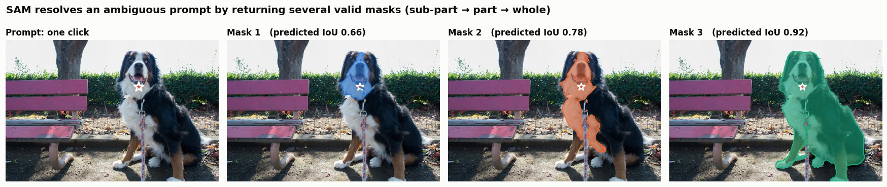
*One click is ambiguous (face? front? whole dog?), so SAM returns three masks with confidence scores.*

**Vision-language models (VLMs)** — the dominant recipe is

```
image ──► vision encoder (CLIP/SigLIP/DINO ViT) ──► projector (MLP) ──► LLM ──► text
                                                       ▲
                                         text prompt ──┘
```

- LLaVA (2023) showed a simple MLP projector + visual instruction tuning works.
- Open models: Qwen2.5-VL / Qwen3-VL, InternVL, Gemma 3, Molmo, PaliGemma 2. They output text
  that can encode **boxes and points** (grounding), which is what makes them useful labelers.
- Closed frontier models (Gemini, GPT, Claude) handle documents, charts, and multi-image reasoning.

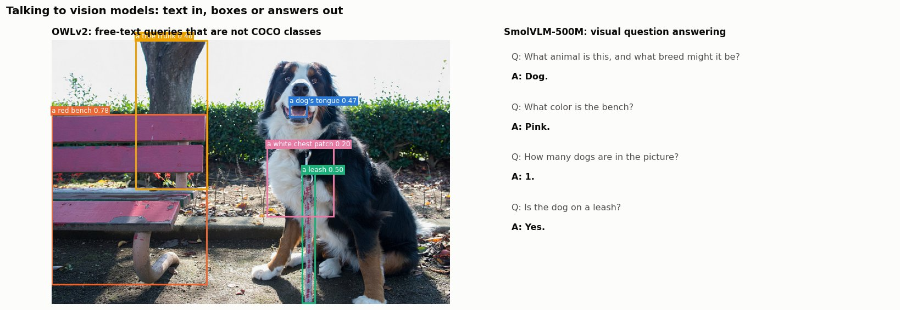
*Text in, boxes or answers out. Note the loose "tree trunk" box, and that the VLM silently skips
the "what breed" half of the question: good material for the weaknesses below.*

**Known weaknesses** (great discussion material): counting, fine spatial relations,
hallucinating objects that are not there, small objects, and domain shift (e.g., X-ray, thermal).

---

## 5. Generative computer vision (8 min)

| Era | Model family | Key idea |
|---|---|---|
| 2014–2019 | GANs (StyleGAN, BigGAN) | Generator vs discriminator game |
| 2020–2022 | Diffusion (DDPM, ADM, Stable Diffusion/LDM) | Learn to denoise; latent space for efficiency |
| 2023– | Diffusion Transformers (DiT, SiT), flow matching (SD3, FLUX) | Replace U-Net with a ViT; straighter probability paths |
| 2024– | Visual autoregressive (VAR, MAR) | Next-scale / next-token prediction for images |
| 2024– | Video & world models (Sora, Veo 3, Cosmos, Genie 3) | Generate consistent, controllable video; simulate environments |

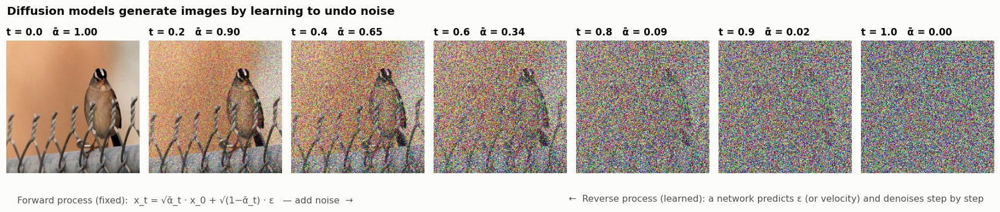
*The forward (noising) process on a real photo with a cosine schedule. A diffusion model is trained to
run this backwards.*

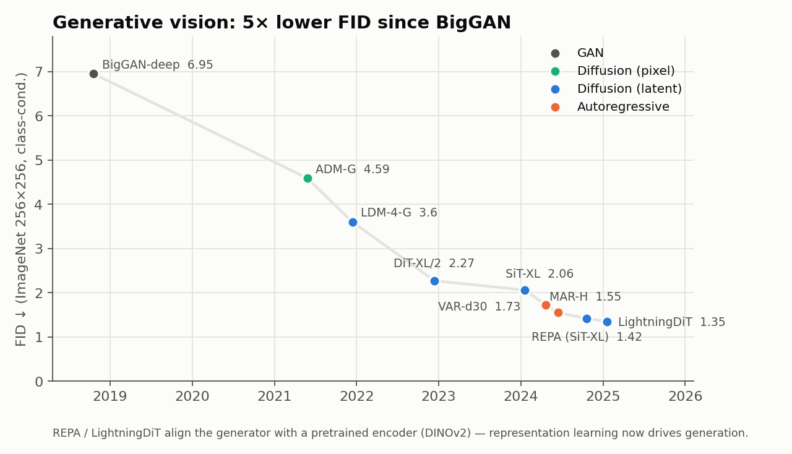

**Why perception people care**

- **Representation ↔ generation are converging.** REPA (2024) speeds up DiT training ~17× by aligning
  its hidden states with frozen DINOv2 features; LightningDiT's VA-VAE aligns the latent space
  itself. Good features make good generators.
- **Synthetic data** for rare cases — e.g., night-time pedestrians, rare pathologies.
- **World models** (Cosmos, GAIA-2, Genie 3) generate future frames conditioned on actions, giving
  robots and cars a learned simulator for training and evaluation.
- Caveat: FID is an imperfect metric; human preference and downstream-utility evaluations matter.

---

## 6. Domain foundation models (12 min)

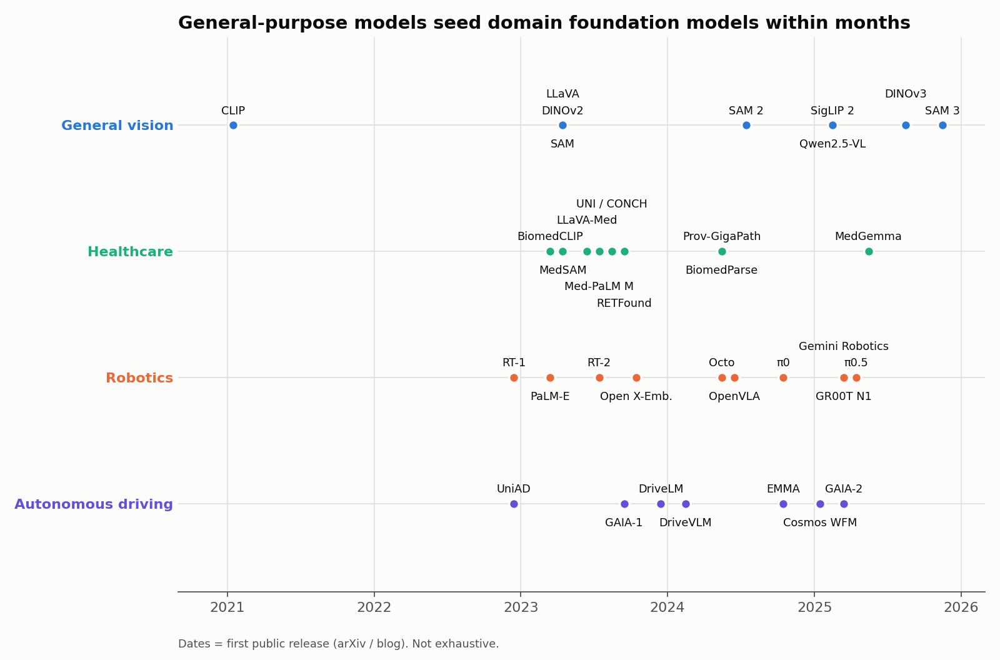

### 6a. Healthcare

| Area | Models | Notes |
|---|---|---|
| Segmentation | **MedSAM** (Nat. Comm. 2024), SAM-Med2D/3D, **BiomedParse** (Nat. Methods 2025) | SAM fine-tuned on ~1.5M medical image–mask pairs; text-prompted parsing across 9 modalities |
| Pathology | **UNI**, **CONCH** (Nat. Med. 2024), **Prov-GigaPath** (Nature 2024), Virchow | DINOv2-style SSL on 100k–1M+ whole-slide images |
| Ophthalmology | **RETFound** (Nature 2023) | MAE on 1.6M retinal images; also predicts systemic disease |
| Vision-language | BiomedCLIP, LLaVA-Med, Med-PaLM M, **MedGemma** (2025) | Report generation, VQA, open-weight medical VLMs |

Discussion: privacy and data access → why **self-supervised** learning dominates here; why
regulatory validation (subgroup performance, calibration) matters more than benchmark SOTA.

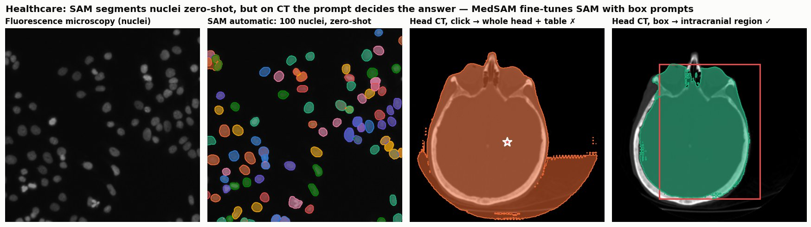
*SAM segments ~100 nuclei zero-shot, but on a head CT a single click returns the head plus the
scanner table; a box prompt gets the intracranial region. This is why MedSAM fine-tunes SAM with
box prompts on medical data.*

### 6b. Robotics

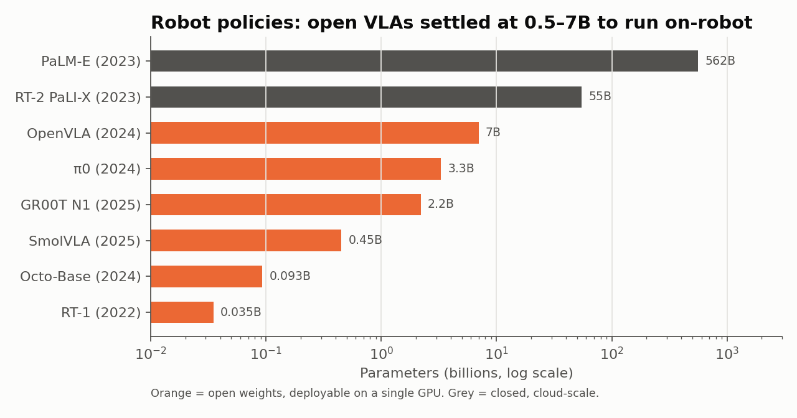

- **RT-2 (2023)** — fine-tune a web VLM to output robot actions as tokens: "vision-language-action".
- **Open X-Embodiment (2023)** — 1M+ trajectories from 22 robot embodiments pooled across 21 institutions.
- **OpenVLA (2024)** — open 7B VLA (Llama 2 + DINOv2 + SigLIP); **π0 / π0.5** (2024–25) use a
  flow-matching *action expert* for smooth 50 Hz control; **GR00T N1** (2025) for humanoids;
  **Gemini Robotics** (2025) for dexterous tasks.
- Trend: sizes are converging to 0.5–7B so the policy fits on the robot; data (not parameters) is
  the bottleneck — hence teleoperation fleets, simulation, and world models.

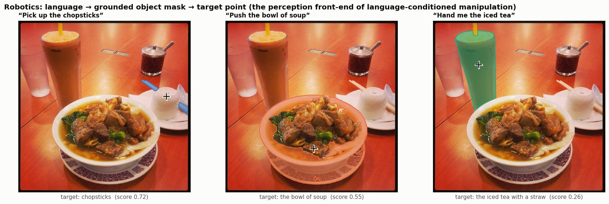
*The perception half of "pick up the chopsticks": language → OWLv2 box → SAM mask → target point.
Modular stacks do this explicitly; VLAs such as OpenVLA and π0 learn it end-to-end.*

### 6c. Self-driving

- **End-to-end planning:** UniAD (CVPR 2023 best paper) unifies detection, tracking, mapping,
  motion forecasting and planning in one network.
- **VLMs for driving:** DriveLM (graph VQA), DriveVLM (VLM + classic planner hybrid), Waymo
  **EMMA** (2024) — a Gemini-based model that maps camera input directly to trajectories, 3D boxes
  and road graphs as text.
- **World models:** GAIA-1/GAIA-2 (Wayve), NVIDIA **Cosmos** (2025) — generate controllable
  driving video for training, testing rare scenarios and closed-loop evaluation.
- Open question: how do you *verify* safety of a model whose reasoning is a black box? (Long tail,
  latency, calibrated uncertainty.)

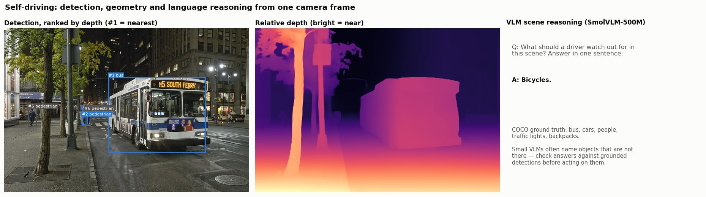
*Detection plus monocular depth ranks road users by distance. Asked about hazards, a 0.5B VLM
answers "Bicycles." — there are none (COCO ground truth). Grounded checks matter.*

---

## 7. Open problems & project kickoff (5 min)

**Open problems**

1. **Evaluation** — benchmarks saturate and leak into training data.
2. **Spatial & 3D understanding** — VLMs still struggle with counting, geometry, metric depth.
3. **Efficiency** — on-device models for robots, cars, and clinics.
4. **Domain shift & long tail** — medical, industrial, thermal, aerial imagery.
5. **Trust** — hallucination, calibration, fairness across patient/population subgroups.

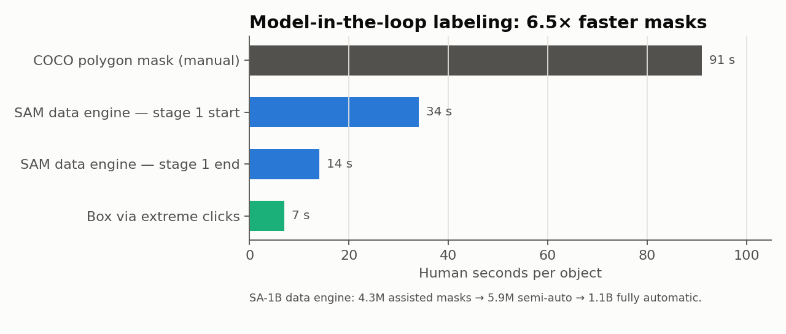

**The data bottleneck is now a *labeling* problem that foundation models can help solve.** SAM's own
dataset was built by a model-in-the-loop engine that cut mask time from ~91 s to 14 s.
Your project asks: *how far can off-the-shelf VLMs + promptable segmenters go as labelers, and
where do humans still need to be in the loop?*

➡️ Project details and a worked example: [Section 8](#8-class-project--foundation-models-as-data-labelers)

---

## 8. Class project — Foundation Models as Data Labelers

**Goal.** Build a labeling pipeline from frozen foundation models (detectors, VLMs, SAM), measure how
good its labels are, and find out where a human is still needed. Laptop or free Colab GPU only; no
large-scale training. Full spec, rubric and domain tracks: [projects/vlm_autolabel](../../projects/vlm_autolabel/README.md).

| Week | Deliverable |
|---|---|
| 1 | Zero-shot baseline (OWLv2) on a 100–200 image COCO subset; mAP, PR curve, failure taxonomy |
| 2 | VLMs + model combinations + a **labeling harness**; ablation table |
| 3 | Human-in-the-loop correction time; train a small YOLO on auto-labels vs. GT labels |
| 4 | 4-page report + 8-minute talk |

**Five strategies to compare (all from frozen models):**

| | Strategy | Models | Idea |
|---|---|---|---|
| A | Detector only | OWLv2 | Class names as text queries |
| B | VLM only | Florence-2 (0.23B) | A VLM that outputs boxes (phrase grounding), no confidence |
| C | Detector + VLM verifier | OWLv2 → SmolVLM-500M | Crop each box, ask "Is this a {class}?", re-score with P(yes) |
| D | Ensemble | OWLv2 + Florence-2 | Fuse boxes; agreement boosts confidence |
| E | Harness | all three | VLM tags classes present → ensemble on those → verify every box |

```bash
cd projects/vlm_autolabel
python make_subset.py --ann annotations/instances_val2017.json \
    --classes "person,car,bicycle,dog,traffic light" --n 100 --out data/coco_subset
python compare_pipelines.py --images data/coco_subset/images --gt data/coco_subset/gt.json --n 40 --out results/
python visualize.py --images data/coco_subset/images --gt data/coco_subset/gt.json \
    --preds results/preds_A.json results/preds_B.json results/preds_E.json \
    --names "A: OWLv2" "B: Florence-2" "E: harness" --min-score 0.15 --out compare.jpg
```

### Worked example (40 COCO val2017 images, 224 ground-truth boxes, MacBook)

| Method | boxes | AP@[.5:.95] | AP@.5 | AR@100 |
|---|---:|---:|---:|---:|
| A detector (OWLv2) | 499 | **0.426** | **0.622** | 0.507 |
| B VLM grounding (Florence-2) | 176 | 0.094 | 0.131 | 0.257 |
| C detector + VLM verifier | 499 | 0.417 | 0.590 | 0.507 |
| D ensemble (OWLv2 + Florence-2) | 573 | 0.373 | 0.535 | **0.509** |
| E harness (tag → ensemble → verify) | 316 | 0.320 | 0.407 | 0.355 |

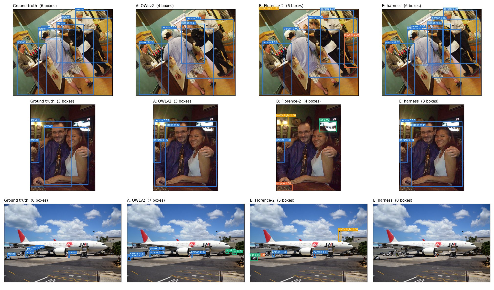

**What the example teaches (and what students should fix):**

- **Naive combinations made things worse.** More models ≠ better labels: the simple fusion and
  gating rules in C–E lose to OWLv2 alone. Designing the combination *is* the project.
- **B has no confidence scores**, so every box is ranked equally and AP collapses; it also
  hallucinates (a barrel labeled "bicycle", a TV labeled "car"). Scores matter as much as boxes.
- **E's image-level tagging is the weak link**: when the 0.5B VLM says "no person" in a crowded
  airport scene, every correct person box is dropped (bottom row). Gating on a weak model is risky;
  use it to *re-weight*, not to *delete*.
- **The verifier helps on persons but hurts on cars**: small crops of distant cars are hard to judge.
  Try more context, bigger VLMs, or count-consistency checks; then measure again.
- **Next step — agentic harness:** give a frontier VLM tools (`detect`, `zoom`, `verify`, `submit`)
  and let it decide what to call; compare AP and $ / 100 images against these baselines.

---

## Further reading (by section)

**Foundations & scaling**
- Dosovitskiy et al., *An Image is Worth 16x16 Words* (ViT), ICLR 2021
- Bommasani et al., *On the Opportunities and Risks of Foundation Models*, 2021
- Dehghani et al., *Scaling Vision Transformers to 22 Billion Parameters*, ICML 2023

**Representation learning**
- Radford et al., *CLIP*, ICML 2021 · Zhai et al., *SigLIP*, ICCV 2023 · Tschannen et al., *SigLIP 2*, 2025
- He et al., *Masked Autoencoders*, CVPR 2022
- Oquab et al., *DINOv2*, TMLR 2024 · Siméoni et al., *DINOv3*, 2025
- Assran et al., *V-JEPA 2*, 2025

**Promptable vision & VLMs**
- Kirillov et al., *Segment Anything*, ICCV 2023 · Ravi et al., *SAM 2*, ICLR 2025 · Carion et al., *SAM 3*, 2025
- Liu et al., *Grounding DINO*, ECCV 2024 · Minderer et al., *OWLv2*, NeurIPS 2023
- Liu et al., *LLaVA: Visual Instruction Tuning*, NeurIPS 2023 · Bai et al., *Qwen2.5-VL*, 2025
- Wang et al., *VGGT: Visual Geometry Grounded Transformer*, CVPR 2025

**Generative vision**
- Peebles & Xie, *DiT*, ICCV 2023 · Tian et al., *VAR*, NeurIPS 2024 · Li et al., *MAR*, NeurIPS 2024
- Yu et al., *REPA: Representation Alignment for Generation*, ICLR 2025
- NVIDIA, *Cosmos World Foundation Model Platform*, 2025

**Healthcare**
- Ma et al., *MedSAM*, Nature Communications 2024
- Chen et al., *UNI*, Nature Medicine 2024 · Lu et al., *CONCH*, Nature Medicine 2024
- Xu et al., *Prov-GigaPath*, Nature 2024 · Zhou et al., *RETFound*, Nature 2023
- Zhao et al., *BiomedParse*, Nature Methods 2025 · Google, *MedGemma Technical Report*, 2025

**Robotics**
- Brohan et al., *RT-2*, CoRL 2023 · Open X-Embodiment Collaboration, ICRA 2024
- Kim et al., *OpenVLA*, CoRL 2024 · Black et al., *π0*, 2024 · NVIDIA, *GR00T N1*, 2025

**Self-driving**
- Hu et al., *UniAD*, CVPR 2023 · Sima et al., *DriveLM*, ECCV 2024 · Tian et al., *DriveVLM*, CoRL 2024
- Hwang et al., *EMMA*, 2024 · Hu et al., *GAIA-1*, 2023

---

### About the figures

All plots are generated by [`make_figures.py`](make_figures.py) from numbers reported in the
original papers/model cards (`python make_figures.py`). They show **trends**; models differ in
training data, resolution and evaluation protocol, so don't read them as a leaderboard.

The example images in `figures/examples/` are real model outputs produced by
[`make_examples.py`](make_examples.py) (CLIP ViT-B/32, OWLv2-base, SAM ViT-B, DINOv2-S,
Depth Anything V2-S, SmolVLM-500M; runs on a laptop in a few minutes).

Photo credits — COCO val2017 / Flickr:
[bus at night](http://farm9.staticflickr.com/8046/8140155314_abf7a6c841_z.jpg) (CC BY 2.0),
[noodle soup](http://farm6.staticflickr.com/5529/9471702865_6cf3a45fde_z.jpg) (CC BY 2.0),
[dog on bench](http://farm9.staticflickr.com/8325/8113006533_a2d7ac54d0_z.jpg) (CC BY-SA 2.0),
[sparrow](http://farm6.staticflickr.com/5004/5248448434_92747c5db2_z.jpg) (CC BY 2.0).
Microscopy and head CT: scikit-image sample data (`human_mitosis`, `brain`).
