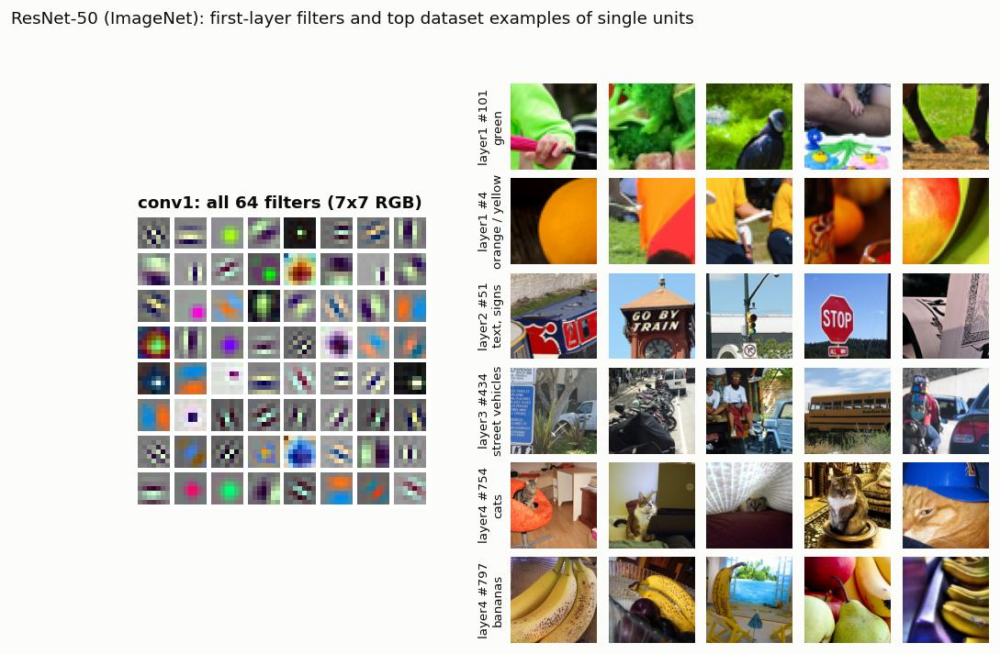
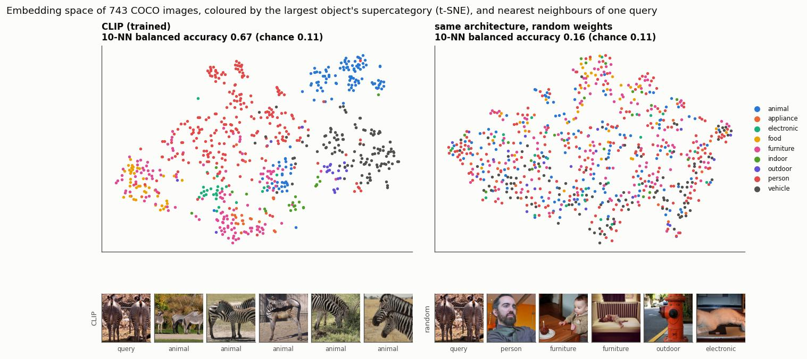
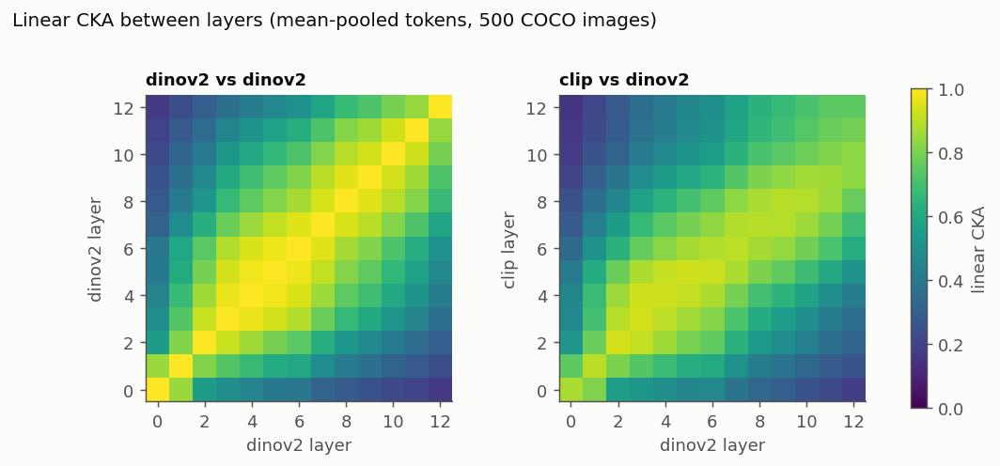
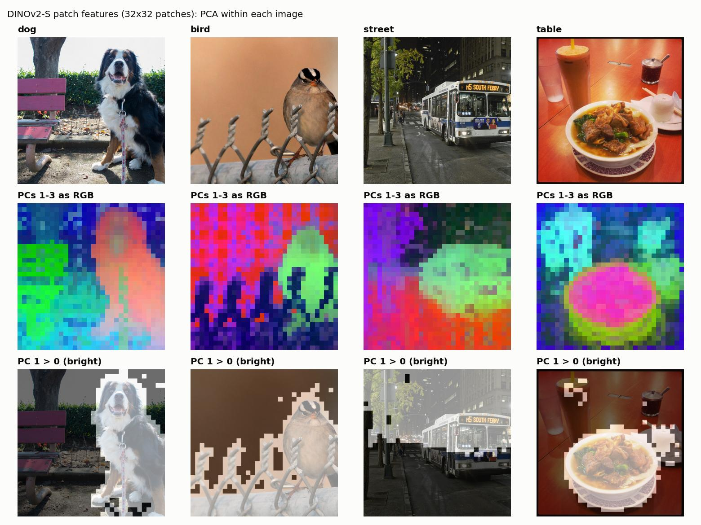
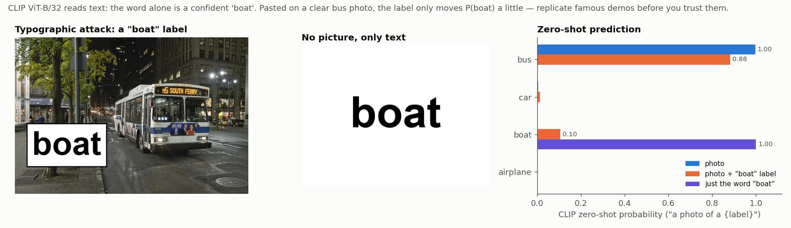
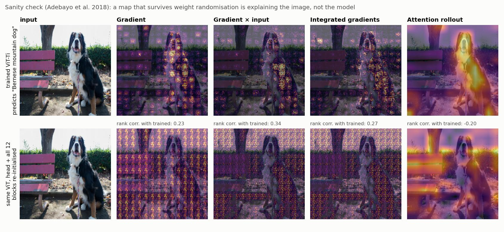
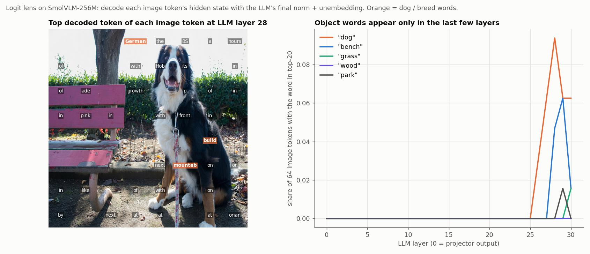
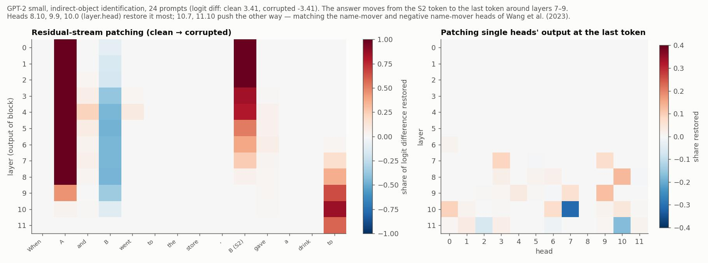
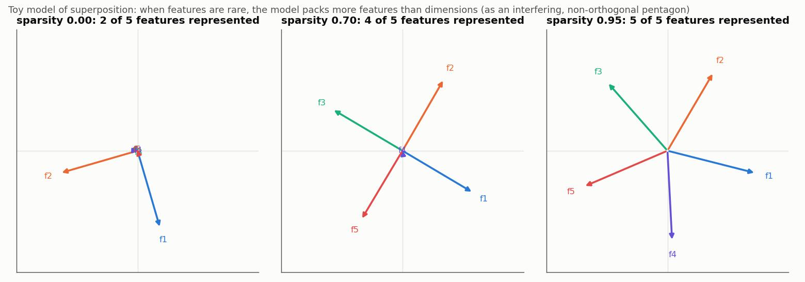

# Lecture 02 — Interpretability: What Have Vision Models Learned?

**Duration:** 60 minutes · **Format:** lecture + discussion · **Hands-on:** [Take-home — What has a vision model learned?](../../projects/interp_takehome/README.md)

> **Big idea.** Lecture 01 showed that one pretrained model now does the work of many task models, and
> that it learns its features from labels, from captions, or from no annotation at all. This lecture asks
> **what those features are**. We start with the basic objects (units, layers, embeddings, receptive
> fields), then look at what a trained vision model represents at each scale, then ask where it looks
> when it decides, and finally follow the same tools into vision-language models and LLMs. One habit
> carries through: **a picture of the model is a hypothesis; test it with a control or an intervention.**

---

## Agenda

| Time | Block | Key question |
|------|-------|--------------|
| 0–5 | 1. Why look inside a model? | What counts as evidence? |
| 5–15 | 2. Basics: what is a representation? | What exactly are we looking at? |
| 15–32 | 3. What has a vision model learned? | Units, embedding spaces, layers, invariances |
| 32–40 | 4. Where does the model look? | Can we trust a saliency map? |
| 40–49 | 5. Vision-language models | Does the answer come from the image or the language prior? |
| 49–57 | 6. Beyond vision: language models in brief | Can we find the algorithm inside the weights? |
| 57–60 | 7. Summary + take-home | |

---

## 1. Why look inside a model? (5 min)

1. **Debugging.** A model scores 95%, but uses the wrong evidence: a hospital token on chest X-rays, snow
   behind huskies, the watermark on horse photos. Accuracy alone does not reveal this; looking inside does.
2. **Science.** Different training signals (labels, captions, no labels) produce models with similar
   accuracy. Do they also learn similar features?
3. **Trust and safety.** Medical, driving and other high-stakes systems need evidence about *why* a model
   decides, not just how often it is right.

**The ladder of evidence.** We use it all lecture to judge a claim:

| Level | Method type | Example | What it can show |
|---|---|---|---|
| 1. Look | Visualise filters, activations, attention, saliency | "Unit 754 fires on cats" | Something to test |
| 2. Decode | Linear probe, nearest neighbours, logit lens | "Layer 8 linearly encodes *dog*" | Information is *present* |
| 3. Intervene | Ablate, patch, edit, steer | "Removing that direction stops the model predicting *dog*" | Information is *used* |
| 4. Explain | A mechanism that predicts behaviour on new inputs | Curve detectors, induction heads | How it works |

Every level needs a **control**: the same method on a random-weight network, shuffled labels, or a
trivial baseline. Many published findings stop at level 1 without one.

---

## 2. Basics: what is a representation? (10 min)

### 2a. Units, layers and feature maps

A deep network is a stack of functions, $f = h_L \circ \dots \circ h_2 \circ h_1$. The **activation** at
layer $l$ is $a_l(x) = h_l(\dots h_1(x))$. Its shape depends on the architecture:

| | CNN (e.g. ResNet-50) | Vision Transformer (e.g. ViT-B/16) |
|---|---|---|
| Activation at layer $l$ | $C \times H \times W$ (channels × height × width) | $T \times D$ (tokens × width): 1 [CLS] + $(224/16)^2 = 196$ patch tokens |
| A **unit** / neuron | One channel $c$: a feature map $a_l(x)_{c,\cdot,\cdot}$ | One dimension $d$ of the residual stream |
| Spatial position | A pixel $(i, j)$ of the feature map | A patch token |
| Image-level vector | Global average pooling over $(i, j)$ | The [CLS] token or the mean of patch tokens |

The **representation** at layer $l$ is the map $x \mapsto a_l(x)$. Asking "what has the model learned?"
means asking which differences between inputs this map keeps (**selectivity**) and which it throws
away (**invariance**). A classifier needs both: keep "cat vs dog", discard lighting and position.

### 2b. Receptive fields

A unit in a CNN sees only part of the image, its **receptive field**. For a stack of layers with kernel
sizes $k_l$ and strides $s_l$, the receptive field $r$ and the step between neighbouring units $j$ grow as

$$
r_l = r_{l-1} + (k_l - 1)\, j_{l-1}, \qquad j_l = j_{l-1}\, s_l, \qquad r_0 = j_0 = 1 .
$$

| ResNet-50 stage | Output size (224 input) | Step $j$ | Theoretical receptive field |
|---|---|---|---|
| conv1 | 112 × 112 × 64 | 2 | 7 px |
| layer1 | 56 × 56 × 256 | 4 | 35 px |
| layer2 | 28 × 28 × 512 | 8 | 91 px |
| layer3 | 14 × 14 × 1024 | 16 | 267 px |
| layer4 | 7 × 7 × 2048 | 32 | 427 px (larger than the image) |

The **effective** receptive field, the region that actually changes the output, is much smaller and
roughly Gaussian (Luo et al. 2016). In a ViT, every token can attend to every other token from the first
block on, so the receptive field is the whole image from layer 1. Whether a ViT *uses* that is an
empirical question; many early heads attend mostly locally (Raghu et al. 2021).

### 2c. How the training signal shapes the representation

The loss decides what the network must keep. Compare the models used today and in the take-home:

| Training signal | Example | What it must keep | What it may throw away |
|---|---|---|---|
| Supervised classification (cross-entropy over $K$ labels) | ResNet-50, ViT on ImageNet | Whatever separates the $K$ classes | Within-class detail; anything not in the label set |
| Contrastive image–text (match each image to its caption) | CLIP | Whatever captions mention, including written text | Spatial layout; details nobody writes about |
| Self-distillation across augmented views | DINO, DINOv2 | What two crops of one image share | Everything the augmentations change: colour, crop, blur |
| Masked reconstruction | MAE | Enough detail to repaint missing patches | Little, so linear probes are weaker |
| None (random weights) | control | Low-level statistics that survive random projections | — |

**Linear representation hypothesis.** Many concepts appear to be encoded as *directions* in activation
space: a concept $c$ is present when $w_c^\top a_l(x)$ is large. This is why linear probes, concept
vectors and steering work at all, and why it is a hypothesis to test rather than assume.

---

## 3. What has a vision model learned? (17 min)

### 3a. Units: filters, dataset examples, dissection

Four ways to describe a single unit, from cheapest to most quantitative:

1. **Look at the weights.** Only the first layer's filters live in pixel space, so only they can be
   shown directly.
2. **Dataset examples** (Zeiler & Fergus 2014). Run many images, find where the unit fires most, and
   crop its receptive field around that peak.
3. **Feature visualisation** (Olah et al. 2017). Optimise an input
   $x^\ast = \arg\max_x \, a_{l,c}(x) - \lambda R(x)$ to excite the unit, where $R$ is a regulariser
   (jitter, blur, a frequency penalty). Without $R$ you get adversarial noise.
4. **Network dissection** (Bau et al. 2017). Threshold the unit's activation map at its top 0.5–1% level,
   upsample it, and compute the IoU with segmentation masks of labelled concepts over a dataset. A unit
   whose best IoU exceeds a threshold (0.04 in the paper) is called a detector for that concept.


*ResNet-50 trained on ImageNet. Left: the 64 first-layer filters are oriented edges, colour blobs and
colour-opponent patterns, similar to Gabor filters and to simple cells in the visual cortex. Right: top
dataset examples for six units, cropped to each stage's receptive field. `layer1` units respond to a
colour, a `layer2` unit to text and signs, `layer4` units to whole objects (cats, bananas). The
hierarchy runs from edges and colours to textures and patterns, then to parts and objects.*

**Talking points**

- **The hierarchy is real but blurry.** Many units respond to several unrelated things
  (**polysemanticity**); the `layer3` unit above fires on a mix of street scenes. Section 6 explains one
  reason: superposition.
- **Dissection needs a control.** In the take-home, a *random-weight* ResNet also produces "zebra
  detectors": stripe texture alone overlaps zebra masks above the 0.04 threshold.
- **Selecting units because they look interpretable is a bias.** Always show some random units too.

### 3b. The embedding space: neighbours, probes, maps

For image-level questions, use the final embedding $z = f(x) \in \mathbb{R}^D$. Three standard checks:

| Method | Question | How |
|---|---|---|
| k-nearest neighbours | Are similar images close together? | Cosine similarity $z_i^\top z_j / (\lVert z_i\rVert\,\lVert z_j\rVert)$; majority vote of the $k$ closest training images |
| Linear probe (Alain & Bengio 2016) | Is the label *linearly* decodable? | Logistic regression $p(y \mid z) = \sigma(w^\top z + b)$ on frozen features, evaluated on held-out images |
| 2-D map (t-SNE, UMAP) | What does the space look like? | Non-linear projection to two dimensions, for looking only |


*CLIP embeddings of 743 COCO images, coloured by the largest object's supercategory. With trained
weights, animals, vehicles, food and furniture form regions, and a zebra's nearest neighbours are all
zebras (10-NN balanced accuracy 0.67). The same architecture with random weights scores 0.16 (chance is
0.11), and its neighbours share only colours.*

**Talking points**

- **t-SNE distances lie.** Cluster sizes and the distances between clusters in a t-SNE map mean little,
  and perplexity can create or hide clusters (Wattenberg et al. 2016). Use it to look; use kNN or probes
  to measure.
- **Probe accuracy ≠ use.** A probe shows that information *can* be read out, not that the model reads
  it. Controls: a random-weight network and shuffled labels (Hewitt & Liang 2019). A probe that is too
  powerful (an MLP) can learn the task itself.
- **kNN vs linear probe.** kNN measures local neighbourhoods and needs no training; a linear probe can
  find a direction that kNN misses. Self-supervised models are usually reported with both.

### 3c. Across layers and across models

**Layer-wise probes** show where information becomes decodable: object identity rises with depth, while
low-level properties (colour, position) can fall. **Representational similarity** compares two
representations of the same $n$ images, $X \in \mathbb{R}^{n \times d_1}$ and
$Y \in \mathbb{R}^{n \times d_2}$, without labels. Linear **CKA** (centred kernel alignment, Kornblith et
al. 2019), with column-centred $X$ and $Y$:

$$
\mathrm{CKA}(X, Y) = \frac{\lVert Y^\top X \rVert_F^2}{\lVert X^\top X \rVert_F \, \lVert Y^\top Y \rVert_F}
$$

It is 1 when the representations match up to a rotation and a uniform scaling, and near 0 when they are
unrelated. Unlike comparing neurons one by one, it does not care that two models order their units
differently.


*Left: DINOv2 against itself. Neighbouring layers are similar and the representation changes gradually
with depth. Right: CLIP against DINOv2. Despite different data, objectives and patch sizes, layers at
similar relative depth are the most similar (CKA up to about 0.9). Different training signals lead to
partly shared representations, an observation sometimes called the "platonic representation
hypothesis" (Huh et al. 2024).*

### 3d. Invariances and spatial structure

- **Invariance** can be measured directly: transform an image (flip, crop, grey-scale, hue shift,
  rotation) and compare $z(x)$ with $z(T(x))$, normalised by how similar unrelated images are.
  Prediction: a model becomes invariant to what its training treated as "the same image". The take-home
  tests this.
- **Shape vs texture.** ImageNet-trained CNNs classify a cat-shaped object with elephant skin as an
  elephant (Geirhos et al. 2019). Shuffling image tiles keeps texture and destroys shape, which tests
  which one a model relies on.
- **Spatial structure in patch tokens.** Self-supervised ViTs keep a map of the image: the attention of
  the [CLS] token and a PCA of the patch features both outline objects without any segmentation labels.


*DINOv2-S patch features (448 px input, 32 × 32 patches). Middle row: the first three principal
components of each image's patch features, shown as RGB. The dog, the bird, the bus and the bowl each
get their own colour. Bottom row: thresholding the first component gives a rough foreground mask. It
works for the dog and the bowl, but it also includes the fence and the upper half of the street.*


*DINOv2-S was never shown a label, yet different last-layer [CLS] heads attend to the main object and to
parts of it (head, body, wheels). This was the original DINO "emerging properties" finding. Darcet et al.
(2024) later showed that ViTs also store global information in a few high-norm background tokens, and
fixed it with extra "register" tokens.*


*CLIP's training signal is text, and it learned to read: an image containing only the word "boat" is
classified as a boat with probability 1.00 (Goh et al. 2021, multimodal neurons). But pasting the word
onto a clear bus photo only moves P(boat) from 0.00 to 0.10, much weaker than the famous "apple → iPod"
demo suggests. Replicate before you believe.*

---

## 4. Where does the model look? Attribution (8 min)

Attribution methods give each input pixel a score for one output, such as the logit $f_c$ of class $c$.

| Method | Idea | Cost | Known issue |
|---|---|---|---|
| Gradient / saliency (Simonyan et al. 2014) | $\partial f_c / \partial x$ | 1 backward | Noisy; saturates |
| Gradient × input | $x \odot \partial f_c / \partial x$ | 1 backward | Partly an edge detector |
| Integrated gradients (Sundararajan et al. 2017) | Average gradient on a path from a baseline $x'$ | ~32 backward | Depends on the baseline |
| Grad-CAM (Selvaraju et al. 2017) | Last conv feature maps weighted by their mean gradient | 1 backward | Coarse (7 × 7 for ResNet-50) |
| Attention rollout (Abnar & Zuidema 2020) | Multiply attention maps through layers | forward only | Attention ≠ importance |
| Occlusion / RISE (Zeiler & Fergus 2014; Petsiuk et al. 2018) | Hide regions, measure the score drop | many forwards | Hidden regions are out of distribution |

Integrated gradients for pixel $i$:

$$
\mathrm{IG}_i(x) = (x_i - x'_i)\int_0^1 \frac{\partial f_c\big(x' + \alpha(x - x')\big)}{\partial x_i}\, d\alpha
$$

Grad-CAM for class $c$ with last-layer feature maps $A^k$:
$\alpha_k = \frac{1}{HW}\sum_{i,j} \partial f_c / \partial A^k_{ij}$, then
$L_c = \mathrm{ReLU}\big(\sum_k \alpha_k A^k\big)$.


*Four attribution maps for a ViT-Tiny ImageNet classifier (top). On the bottom, the same maps after
re-initialising the head and all 12 blocks. The randomised maps change (rank correlation 0.2–0.34), so
these maps do depend on the weights. But gradient × input keeps the most structure because it multiplies
by the image itself. Note also the 16 × 16 checkerboard: ViT gradients carry the patch grid.*

**Talking points**

- **Sanity checks** (Adebayo et al. 2018): if a method gives the same picture when the weights are
  random, it explains the *image* (edges), not the *model*. Guided backprop famously fails this test.
- **Faithfulness** is measured with interventions, such as **deletion curves**: remove the "most
  important" pixels first and check that the score drops faster than with a random order.
- Ask the class: *what does "remove a pixel" mean?* Grey, blur and noise each create a different
  out-of-distribution image, and the metric partly measures that.

---

## 5. Vision-language models (9 min)

Recall the VLM recipe from Lecture 01: `image → vision encoder → projector → LLM → text`. The image
becomes ~64–2,000 "image tokens" inside the language model. Three questions follow:

1. **What do image tokens mean to the LLM?** The **logit lens** decodes a hidden state $h_l$ with the
   LLM's own output layer: $\mathrm{softmax}(W_U\,\mathrm{LN}(h_l))$.
2. **Where does the LLM read the image?** **Attention knockout** stops text tokens from attending to
   image tokens in chosen layers; then we watch the answer.
3. **Why do VLMs hallucinate?** Is the answer driven by the image or by the **language prior**
   ("a kitchen usually has a fork")?


*Logit lens on SmolVLM-256M. In the last layers, some image tokens over the dog decode as "mountain"
(Bernese mountain dog), "bulld(og)" and "German", and a token on the bench decodes as "pink". In this
small model, object words appear only in the last ~5 of 30 layers. Neo et al. (2025) report a clearer
picture in LLaVA.*


*Attention knockout on SmolVLM-256M. Blocking text→image attention in **layers 15–17 only** drops
P(yes) for present objects to ≤ 0.37; other 3-layer windows barely matter. The LLM reads the image
through a narrow band of middle layers. These are 9 questions on one small model: a hypothesis to test,
not a law.*

- **Hallucination benchmarks.** POPE (Li et al. 2023) asks "Is there a {object}?" with absent objects
  sampled at random, from frequent classes, or from classes that **co-occur** with the scene. The
  co-occurrence split exposes the language prior.
- **Mitigations from interpretability.** Visual contrastive decoding (Leng et al. 2024) subtracts the
  prediction made from a distorted image, which removes part of the language prior.

---

## 6. Beyond vision: language models in brief (8 min)

The same toolbox, applied to text-only transformers, became **mechanistic interpretability**: trying to
recover the algorithm a network implements.

**The residual stream.** In a transformer, every attention head and MLP reads from and adds to one
shared vector per token (Elhage et al. 2021):

```
x₀ = embed(token)
x_{l+1} = x_l + Σ_heads Attn_h(x_l) + MLP(x_l + attn)
logits  = W_U · LayerNorm(x_L)        ← the logit lens applies this to any x_l
```


*Logit lens on GPT-2 small. At the last position the guess moves England → East → Rome → London → Paris.
P(" Paris") peaks at layer 10, then drops in the final layers.*

**Activation patching** is the intervention version. Run the model on a clean prompt and a corrupted
prompt, copy one activation from the clean run into the corrupted run, and measure how much of the
clean behaviour comes back (Meng et al. 2022; Wang et al. 2023).


*"When Mary and John went to the store, John gave a drink to" → "Mary". Patching single heads of GPT-2
small finds the heads that Wang et al. (2023) describe (S-inhibition 8.10; name movers 9.9, 10.0;
negative name movers 10.7, 11.10). The choice of corrupted prompt changes the details (Zhang & Nanda
2024).*

**Superposition and sparse autoencoders.** Why are units polysemantic (Section 3a)? A network with more
features than dimensions can store them as non-orthogonal directions, as long as the features are
rarely active together.


*A 2-dimensional hidden layer trained to reconstruct 5 features. With dense features it keeps only the 2
most important; with sparse features it stores all 5 as a pentagon (Elhage et al. 2022).*

A **sparse autoencoder** learns an overcomplete dictionary of sparse features from activations,
$a \approx W_d\,\mathrm{ReLU}(W_e a + b)$, to undo superposition. It has been applied to language models
(Bricken et al. 2023; Templeton et al. 2024) and to vision encoders such as CLIP. Uses include debugging,
model editing, steering, and safety audits.

---

## 7. Summary + take-home (3 min)

1. Start from the basics: **what is the unit, the layer, the receptive field, and the training
   signal?** The training signal predicts much of what a model keeps and what it throws away.
2. Look at several scales: units (look), embeddings and probes (decode), similarity across layers and
   models (compare), invariance tests and interventions (test).
3. **Always run a control:** random weights, shuffled labels, random directions, a trivial baseline.

**Take-home ([full spec](../../projects/interp_takehome/README.md), 6 hours, laptop only, no model
training beyond linear probes):**

| Q | Topic | Models |
|---|---|---|
| 1 | What do single units detect? Filters, dataset examples, dissection vs a random network | ResNet-50 |
| 2 | How is the embedding space organised? kNN, linear probes, t-SNE, retrieval | ResNet-50, ViT, CLIP, DINOv2, random |
| 3 | How does the representation change with depth? Layer-wise probes, CKA | same |
| 4 | What did training make the model ignore? Invariance tests, patch PCA | same |
| 5 | Do saliency maps pass sanity checks? | CLIP |
| 6 | Where does a VLM read the image, and when does it hallucinate? | SmolVLM |
| 7 | Synthesis, and design a shortcut-detection experiment | — |

---

## Further reading (by section)

**Basics and representations**
- Zeiler & Fergus, *Visualizing and Understanding Convolutional Networks*, ECCV 2014
- Luo et al., *Understanding the Effective Receptive Field in Deep CNNs*, NeurIPS 2016
- Olah, Mordvintsev & Schubert, *Feature Visualization*, Distill 2017 · Olah et al., *Zoom In: An Introduction to Circuits*, Distill 2020
- Bau et al., *Network Dissection*, CVPR 2017 · Kim et al., *TCAV*, ICML 2018
- Alain & Bengio, *Understanding Intermediate Layers Using Linear Classifier Probes*, 2016
- Hewitt & Liang, *Designing and Interpreting Probes with Control Tasks*, EMNLP 2019
- Kornblith et al., *Similarity of Neural Network Representations Revisited* (CKA), ICML 2019
- Raghu et al., *Do Vision Transformers See Like Convolutional Neural Networks?*, NeurIPS 2021
- Huh et al., *The Platonic Representation Hypothesis*, ICML 2024
- Geirhos et al., *ImageNet-trained CNNs are Biased towards Texture*, ICLR 2019
- Wattenberg, Viégas & Johnson, *How to Use t-SNE Effectively*, Distill 2016
- Caron et al., *Emerging Properties in Self-Supervised Vision Transformers* (DINO), ICCV 2021 · Oquab et al., *DINOv2*, 2023
- Darcet et al., *Vision Transformers Need Registers*, ICLR 2024
- Goh et al., *Multimodal Neurons in Artificial Neural Networks*, Distill 2021
- Gandelsman, Efros & Steinhardt, *Interpreting CLIP's Image Representation via Text-Based Decomposition*, ICLR 2024

**Attribution**
- Simonyan, Vedaldi & Zisserman, *Deep Inside Convolutional Networks*, ICLR-W 2014
- Sundararajan, Taly & Yan, *Axiomatic Attribution for Deep Networks* (Integrated Gradients), ICML 2017
- Selvaraju et al., *Grad-CAM*, ICCV 2017 · Abnar & Zuidema, *Quantifying Attention Flow*, ACL 2020
- Adebayo et al., *Sanity Checks for Saliency Maps*, NeurIPS 2018 · Petsiuk et al., *RISE*, BMVC 2018

**Vision-language models**
- Li et al., *Evaluating Object Hallucination in Large Vision-Language Models* (POPE), EMNLP 2023
- Leng et al., *Mitigating Object Hallucinations via Visual Contrastive Decoding*, CVPR 2024
- Neo et al., *Towards Interpreting Visual Information Processing in Vision-Language Models*, ICLR 2025

**Language models**
- nostalgebraist, *interpreting GPT: the logit lens*, 2020 · Elhage et al., *A Mathematical Framework for Transformer Circuits*, 2021
- Meng et al., *Locating and Editing Factual Associations in GPT* (ROME), NeurIPS 2022
- Wang et al., *Interpretability in the Wild: a Circuit for Indirect Object Identification in GPT-2 small*, ICLR 2023
- Zhang & Nanda, *Towards Best Practices of Activation Patching*, ICLR 2024
- Elhage et al., *Toy Models of Superposition*, 2022 · Bricken et al., *Towards Monosemanticity*, 2023 · Templeton et al., *Scaling Monosemanticity*, 2024

---

### About the figures

All figures are real model outputs produced by [`make_examples.py`](make_examples.py), about 6 minutes on
a laptop. The representation figures (units, embedding, CKA) use the take-home's 1,000-image COCO
subset, so run [`make_data.py`](../../projects/interp_takehome/make_data.py) first:

```bash
python make_examples.py                 # all figures
python make_examples.py units           # one figure
```

Several figures did **not** come out the way the textbook story predicts: the weak typographic attack,
object words appearing only in late VLM layers, P(" Paris") falling in GPT-2's last layers, and the
patch-PCA foreground including background. They are kept as they are, because noticing that is part of
the lecture.

Photos are COCO val2017 images (credits in Lecture 01).
