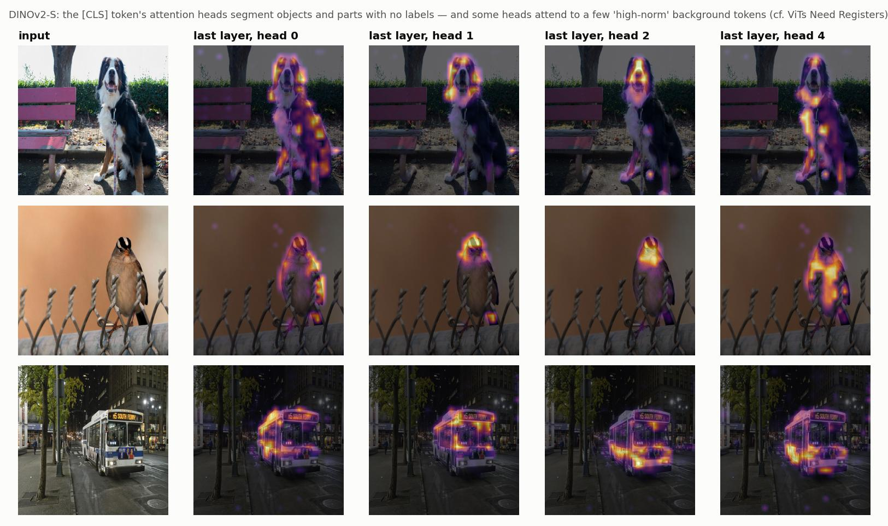
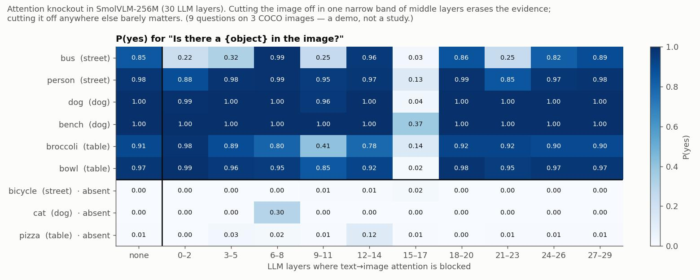
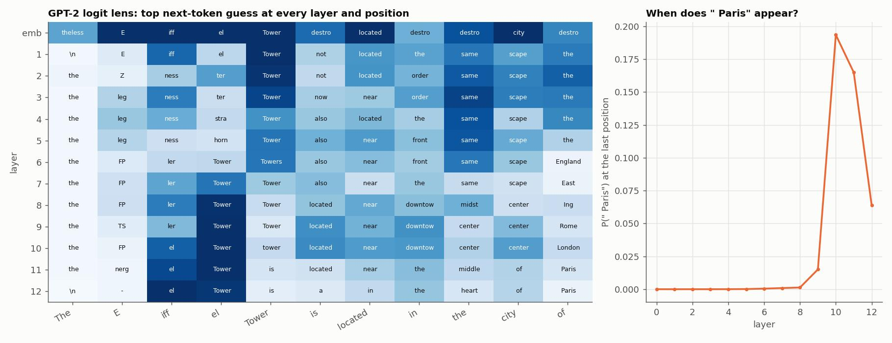

# Lecture 02 — Interpretability: From Vision Models to VLMs to LLMs

**Duration:** 60 minutes · **Format:** lecture + discussion · **Hands-on:** [Take-home — Tracing a concept from pixels to words](../../projects/interp_takehome/README.md)

> **Big idea.** Lecture 01 showed that one pretrained model now does the work of many task models.
> The cost is that we no longer know *how* it does the work. Interpretability asks what a model has
> learned and which internal computations produce an answer. The methods started in computer vision
> (saliency maps, feature visualization, probes). They are now central to the safety of language
> models (circuits, sparse autoencoders, deception probes). We follow that path in three steps:
> **vision encoders → vision-language models → LLMs**. One habit carries through every step:
> **a picture of the model is a hypothesis; test it with an intervention.**

---

## Agenda

| Time | Block | Key question |
|------|-------|--------------|
| 0–5 | 1. Why interpretability, and what counts as an explanation? | Correlation or cause? |
| 5–20 | 2. Interpreting vision models | Where does the model look, and what has it learned? |
| 20–32 | 3. Interpreting vision-language models | Does the answer come from the image or from the language prior? |
| 32–52 | 4. Interpreting LLMs: mechanistic interpretability | Can we find the algorithm inside the weights? |
| 52–60 | 5–6. Interpretability for AI safety + take-home | What would you trust in a safety case? |

---

## 1. Why interpretability? (5 min)

Three reasons to look inside a model:

1. **Debugging and science.** The model scores 95%, but is it using the right evidence? Shortcut
   learning (hospital tokens on X-rays, snow behind huskies) only shows up when you look.
2. **Trust and regulation.** Medical and driving systems need evidence that the model relies on
   clinically or physically meaningful features.
3. **Safety of capable models.** If a model can deceive or pursue a hidden goal, its outputs alone are
   not enough. We would like to read its internal state. This is why Anthropic, Google DeepMind and
   OpenAI all have interpretability teams.

**The ladder of evidence.** We use this ladder all lecture to judge a claim:

| Level | Method type | Example | What it can show |
|---|---|---|---|
| 1. Look | Visualise activations, attention, saliency | "Head 3 attends to the dog" | Something to test |
| 2. Decode | Linear probe, logit lens | "Layer 8 linearly encodes *dog*" | Information is *present* |
| 3. Intervene | Ablate, patch, steer | "Removing that direction stops the model saying *dog*" | Information is *used* |
| 4. Explain | A circuit or algorithm that predicts behaviour on new inputs | IOI circuit, induction heads | A mechanism |

Most published "explanations" stop at level 1 or 2. In the take-home you will be asked to climb at least
one level.

---

## 2. Interpreting vision models (15 min)

### 2a. Attribution: where does the model look?

| Method | Idea | Cost | Known issue |
|---|---|---|---|
| Gradient / saliency (Simonyan et al. 2014) | ∂ score / ∂ pixel | 1 backward | Noisy; saturates |
| Gradient × input | Multiply by the pixel value | 1 backward | Partly an edge detector |
| Integrated gradients (Sundararajan et al. 2017) | Average gradient on a path from a baseline | ~32 backward | Depends on the baseline |
| Grad-CAM (Selvaraju et al. 2017) | Gradient-weighted last conv feature map | 1 backward | Coarse; CNN-specific |
| Attention rollout (Abnar & Zuidema 2020) | Multiply attention maps through layers | forward only | Attention ≠ importance |
| Occlusion / RISE (Zeiler & Fergus 2014; Petsiuk et al. 2018) | Hide regions, measure the score drop | many forwards | Hidden regions are out of distribution |

Integrated gradients for pixel $i$, baseline $x'$:

$$
\mathrm{IG}_i(x) = (x_i - x'_i)\int_0^1 \frac{\partial f\big(x' + \alpha(x - x')\big)}{\partial x_i}\, d\alpha
$$


*Four attribution maps for a ViT-Tiny ImageNet classifier (top). On the bottom, the same maps after
re-initialising the head and all 12 blocks. The randomised maps change (rank correlation 0.2–0.34), so
these maps do depend on the weights. But gradient × input keeps the most structure because it multiplies
by the image itself. Note also the 16 × 16 checkerboard: ViT gradients carry the patch grid.*

**Talking points**

- **Sanity checks for saliency maps** (Adebayo et al. 2018): if a method gives the same picture when the
  weights are random, it is explaining the *image* (edges), not the *model*. Guided backprop famously fails
  this test.
- A plausible-looking map is not a faithful one. Faithfulness is measured with interventions such as
  **deletion curves**: remove the "most important" pixels first and see whether the score drops faster
  than with a random order.
- Ask the class: *what does "remove a pixel" mean?* Grey, blur and noise each create a different
  out-of-distribution image. The metric partly measures that.

### 2b. Representations: what has the model learned?

| Method | Question it answers | Representative work |
|---|---|---|
| Feature visualization | What input maximises this neuron? | Olah et al., *Feature Visualization* (Distill 2017) |
| Network dissection | Which neurons match human-labelled concepts? | Bau et al. (CVPR 2017) |
| Concept activation vectors (TCAV) | How sensitive is a class to a concept direction? | Kim et al. (ICML 2018) |
| Linear probes | Is a property linearly decodable at layer *l*? | Alain & Bengio (2016) |
| Multimodal neurons | Does one unit respond to a concept as photo, drawing *and* word? | Goh et al., *Multimodal Neurons* (Distill 2021) |
| Decomposing CLIP by heads and text | Which heads write which concepts? | Gandelsman et al. (ICLR 2024) |
| Sparse autoencoders on vision | Dictionary of interpretable features | SAEs on CLIP/DINO (2024–25) |


*DINOv2-S was never shown a label, yet its last-layer [CLS] heads separate the main object (dog, bird,
bus) and parts of it (head, body, wheels). This was the original DINO "emerging properties" finding.
Darcet et al. (2024) later showed that ViTs also store global information in a few high-norm background
tokens, and fixed it with extra "register" tokens.*


*CLIP reads text: an image containing only the word "boat" is classified as a boat with probability 1.00.
This is the multimodal-neuron story. But pasting the word onto a clear bus photo only moves P(boat) from
0.00 to 0.10, much weaker than the famous "apple → iPod" demo suggests. Replicate before you believe.*

**Talking points**

- **Probe accuracy ≠ use.** A probe shows the information *can* be read out, not that the model reads it.
  Use controls: a random-weight network of the same architecture, and shuffled labels (Hewitt & Liang 2019).
- **Polysemanticity.** Single neurons often respond to several unrelated concepts. This motivates the
  superposition and sparse autoencoder work in Section 4.

---

## 3. Interpreting vision-language models (12 min)

Recall the VLM recipe from Lecture 01: `image → vision encoder → projector → LLM → text`. The image
becomes ~64–2,000 "image tokens" in the LLM's residual stream. That gives us new questions:

1. **What do image tokens mean to the LLM?** Use the **logit lens**: decode an image token's hidden
   state with the LLM's own unembedding.
2. **Where does the LLM read the image?** Use **attention knockout**: stop text tokens from attending to
   image tokens in chosen layers, then watch the answer.
3. **Why do VLMs hallucinate?** Is the answer driven by the image or by the **language prior**? For
   example, "a kitchen usually has a fork".


*Logit lens on SmolVLM-256M. In the last layers, some image tokens over the dog decode as "mountain"
(Bernese mountain dog), "bulld(og)" and "German", and a token on the bench decodes as "pink". In this
small model, object words appear only in the last ~5 of 30 layers and in few tokens. Neo et al. (2025)
report a similar, clearer picture in LLaVA.*


*Attention knockout on SmolVLM-256M. Blocking text→image attention in **layers 15–17 only** drops
P(yes) for present objects to ≤ 0.37. Blocking any other 3-layer window barely matters. The LLM reads
the image through a narrow band of middle layers. The decision then forms later, where the logit lens
sees words.*

**Talking points**

- **Hallucination benchmarks.** POPE (Li et al. 2023) asks "Is there a {object}?" with absent objects
  sampled at random, from frequent classes, or from classes that **co-occur** with the scene
  (adversarial). The adversarial split exposes the language prior.
- **Mitigations come from interpretability.** Contrastive decoding against a distorted image (VCD,
  Leng et al. 2024) subtracts the language-prior prediction. Causal-tracing work on VLMs (Basu et al.
  2024) locates where visual facts are stored and edits them.
- **Small-model caution.** Every result in these figures comes from a 256M model and nine questions. A
  pattern in one model is a hypothesis for the next model, not a law.

---

## 4. Interpreting LLMs: mechanistic interpretability (20 min)

### 4a. The residual stream view

A transformer is a **residual stream** that every attention head and MLP reads from and writes to
(Elhage et al. 2021, *A Mathematical Framework for Transformer Circuits*). Because the writes are added,
we can ask what each component contributes:

```
x₀ = embed(token)
x_{l+1} = x_l + Σ_heads Attn_h(x_l) + MLP(x_l + attn)
logits  = W_U · LayerNorm(x_L)        ← the logit lens applies this to any x_l
```


*Logit lens on GPT-2 small. At the last position the guess moves England → East → Rome → London → Paris.
P(" Paris") peaks at layer 10, then *drops* in the final layers. The logit lens is a rough tool; the
**tuned lens** (Belrose et al. 2023) learns a small correction per layer.*

### 4b. Causal methods: activation patching

Run the model on a **clean** prompt and a **corrupted** prompt. Copy one activation from the clean run
into the corrupted run and measure how much of the clean behaviour comes back. Also called causal
tracing (Meng et al. 2022, ROME) or interchange intervention.


*Indirect-object identification in GPT-2 small: "When Mary and John went to the store, John gave a drink
to" → "Mary". Patching the residual stream shows the name information moving from the repeated name (S2)
to the final token around layers 7–9. Patching single heads finds the same heads that Wang et al. (2023)
call S-inhibition (8.10), name movers (9.9, 10.0) and negative name movers (10.7, 11.10). The whole
figure takes about one minute on a laptop.*

**Talking points**

- **Choices change conclusions** (Zhang & Nanda 2024; Heimersheim & Nanda 2024): the corruption (swap
  names or use new names), the metric (logit difference or probability), and the direction (denoising
  clean→corrupt or noising corrupt→clean) can all give different "circuits".
- **Known circuits:** induction heads for in-context copying (Olsson et al. 2022), IOI (Wang et al.
  2023), and later attribution graphs that trace multi-step reasoning in a production model (Anthropic,
  *On the Biology of a Large Language Model*, 2025).

### 4c. Superposition and sparse autoencoders


*A 2-dimensional hidden layer trained to reconstruct 5 features. When features are dense it keeps only
the 2 most important. When they are sparse it stores all 5 as a pentagon of non-orthogonal directions
(Elhage et al. 2022). Real models do this with far more features than neurons, which is why single
neurons are polysemantic.*

- **Sparse autoencoders (SAEs)** learn an overcomplete dictionary of sparse features from activations:
  $h \approx W_d\,\mathrm{ReLU}(W_e h + b)$. Anthropic's *Towards Monosemanticity* (2023) did this on a
  one-layer model; *Scaling Monosemanticity* (2024) found millions of features in Claude 3 Sonnet,
  including ones for deception, sycophancy and code bugs. Steering one feature produced "Golden Gate
  Claude".
- Open SAEs exist for GPT-2 small and Gemma 2 (Gemma Scope, 2024). You can explore them without
  training anything.
- **Steering and representation reading:** adding a direction (activation addition, Turner et al. 2023;
  representation engineering, Zou et al. 2023) changes behaviour. That is a level-3 test of a level-2
  finding.

---

## 5. Interpretability for AI safety (5 min)

This is where Lecture 02 meets the Anthropic research agenda:

| Safety question | Interpretability tool | What can go wrong |
|---|---|---|
| Is the model lying? | Linear "deception" probes (Apollo, 2025; RepE) | Probe detects the *prompt style*, not deception; off-policy training data |
| Is its reasoning honest? | Chain-of-thought faithfulness tests (hinted prompts, early answering) | Unverbalised hints; post-hoc rationalisation |
| Did fine-tuning plant a hidden trait? | Model diffing, SAE features, subliminal-learning analyses | Signal hides in "meaningless" data |
| Can we audit a model before deployment? | Attribution graphs, feature search, auditing games | Evaluation awareness; methods miss rare behaviour |

**Discussion:** *Which level of the evidence ladder would you need before putting an interpretability
result into a safety case?* The take-home asks you to make that argument with your own data.

---

## 6. Take-home — Tracing a concept from pixels to words

**Goal.** Run the main interpretability methods on one concept, *"is there an X in the image?"*, at three
levels: a vision encoder (CLIP / DINOv2), a VLM (SmolVLM) and an LLM (GPT-2). For each claim, find out
whether it survives a control or an intervention. Laptop or free Colab GPU only; **no model training
beyond linear probes**. Full spec: [projects/interp_takehome](../../projects/interp_takehome/README.md).

| Part | Model | Question | Starter script |
|---|---|---|---|
| A1 | CLIP ViT-B/32 | Do saliency maps pass randomisation and deletion tests? | `part_a_saliency.py` |
| A2 | CLIP, DINOv2, random CLIP | Where is object presence linearly decodable? Is the direction *used*? | `part_a_probe.py` |
| B | SmolVLM-256M / 500M | Where is the image read? Can hidden states predict hallucinations? | `part_b_vlm.py` |
| C | GPT-2 small | Does the IOI circuit replicate, and does it depend on the corruption? | `part_c_llm.py` |

Like the Anthropic Fellows and Constellation take-homes, it is **time-boxed (6 hours)**. It asks for
**pre-registered predictions before each experiment**, and it grades whether your claims match your
evidence.

---

## Further reading (by section)

**Attribution in vision**
- Simonyan, Vedaldi & Zisserman, *Deep Inside Convolutional Networks*, ICLR-W 2014
- Sundararajan, Taly & Yan, *Axiomatic Attribution for Deep Networks* (Integrated Gradients), ICML 2017
- Selvaraju et al., *Grad-CAM*, ICCV 2017 · Abnar & Zuidema, *Quantifying Attention Flow*, ACL 2020
- Adebayo et al., *Sanity Checks for Saliency Maps*, NeurIPS 2018 · Petsiuk et al., *RISE*, BMVC 2018

**Representations in vision**
- Olah et al., *Feature Visualization*, Distill 2017 · Bau et al., *Network Dissection*, CVPR 2017
- Kim et al., *TCAV*, ICML 2018 · Alain & Bengio, *Understanding Intermediate Layers Using Linear Classifier Probes*, 2016
- Hewitt & Liang, *Designing and Interpreting Probes with Control Tasks*, EMNLP 2019
- Goh et al., *Multimodal Neurons in Artificial Neural Networks*, Distill 2021
- Caron et al., *Emerging Properties in Self-Supervised Vision Transformers* (DINO), ICCV 2021
- Darcet et al., *Vision Transformers Need Registers*, ICLR 2024
- Gandelsman, Efros & Steinhardt, *Interpreting CLIP's Image Representation via Text-Based Decomposition*, ICLR 2024

**Vision-language models**
- Li et al., *Evaluating Object Hallucination in Large Vision-Language Models* (POPE), EMNLP 2023
- Leng et al., *Mitigating Object Hallucinations via Visual Contrastive Decoding*, CVPR 2024
- Neo et al., *Towards Interpreting Visual Information Processing in Vision-Language Models*, ICLR 2025
- Basu et al., *Understanding Information Storage and Transfer in Multi-modal Large Language Models*, NeurIPS 2024

**LLMs: mechanistic interpretability**
- nostalgebraist, *interpreting GPT: the logit lens*, 2020 · Belrose et al., *Tuned Lens*, 2023
- Elhage et al., *A Mathematical Framework for Transformer Circuits*, 2021
- Olsson et al., *In-context Learning and Induction Heads*, 2022
- Meng et al., *Locating and Editing Factual Associations in GPT* (ROME), NeurIPS 2022
- Wang et al., *Interpretability in the Wild: a Circuit for Indirect Object Identification in GPT-2 small*, ICLR 2023
- Zhang & Nanda, *Towards Best Practices of Activation Patching*, ICLR 2024 · Heimersheim & Nanda, *How to Use and Interpret Activation Patching*, 2024
- Elhage et al., *Toy Models of Superposition*, 2022 · Bricken et al., *Towards Monosemanticity*, 2023
- Templeton et al., *Scaling Monosemanticity*, 2024 · Lieberum et al., *Gemma Scope*, 2024
- Ameisen et al., *Circuit Tracing* and Lindsey et al., *On the Biology of a Large Language Model*, 2025
- Turner et al., *Activation Addition*, 2023 · Zou et al., *Representation Engineering*, 2023

**Safety applications** (see also the papers in the take-home packages)
- Goldowsky-Dill et al. (Apollo Research), *Detecting Strategic Deception Using Linear Probes*, 2025
- Chen et al. (Anthropic), *Reasoning Models Don't Always Say What They Think*, 2025
- Cloud et al., *Subliminal Learning*, 2025

---

### About the figures

All figures are real model outputs produced by [`make_examples.py`](make_examples.py) (ViT-Tiny ImageNet
classifier, CLIP ViT-B/32, DINOv2-S, SmolVLM-256M, GPT-2 small; ~4 minutes on a laptop):

```bash
python make_examples.py                 # all figures
python make_examples.py vlm_knockout    # one figure
```

Several figures did **not** come out the way the textbook story predicts: the weak typographic attack,
object words appearing only in late VLM layers, and P(" Paris") falling in GPT-2's last layers. They are
kept as they are because noticing that is the point of the lecture.

Photos are the same COCO val2017 images used in Lecture 01 (credits there).
